# MyChat（去中心化安全社交网络）产品设计报告

| 项目名称 | MyChat —— 去中心化安全社交网络（Decentralized Secure Social Network） |
| --- | --- |
| 文档类型 | 产品设计报告（Product & Technical Design） |
| 版本 | v1.0 |
| 日期 | 2026-10-29 |
| 状态 | 初稿（供评审） |
| 需求输入 | [需求分析报告](./需求分析报告.md) |

## 修订记录

| 版本 | 日期 | 修订人 | 修订说明 |
| --- | --- | --- | --- |
| v1.0 | 2026-10-29 | 产品组 | 首个完整版本 |
| v1.1 | 2026-10-31 | 产品组 | 项目由 DSSN 更名为 MyChat，产品定位不变 |

---

## 目录

1. [产品定位与设计原则](#1-产品定位与设计原则)
2. [总体架构设计](#2-总体架构设计)
3. [关键设计决策（ADR）](#3-关键设计决策adr)
4. [身份与密钥管理设计](#4-身份与密钥管理设计)
5. [隐私保护通信设计](#5-隐私保护通信设计)
6. [数据存储与所有权设计](#6-数据存储与所有权设计)
7. [社交功能模块设计](#7-社交功能模块设计)
8. [群组系统设计](#8-群组系统设计)
9. [反滥用与治理设计](#9-反滥用与治理设计)
10. [客户端与交互设计](#10-客户端与交互设计)
11. [协议与数据模型](#11-协议与数据模型)
12. [性能与容量设计](#12-性能与容量设计)
13. [安全设计复查（威胁→对策矩阵）](#13-安全设计复查)
14. [里程碑与路线图](#14-里程碑与路线图)
15. [度量与验收对照](#15-度量与验收对照)
16. [开放问题](#16-开放问题)

---

## 1. 产品定位与设计原则

### 1.1 一句话定位

> **MyChat 是一个"数据完全属于你"的社交网络：拥有中心化平台的使用便利，但不需要信任任何第三方——内容端到端加密、元数据被架构性保护、密钥丢失可以找回来。**

### 1.2 价值主张三角

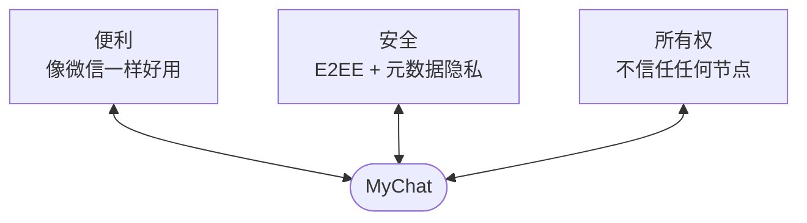

三者缺一即退化为既有方案：只有便利+安全 = Signal（中心化目录）；只有便利+所有权 = Mastodon（信任实例）；只有安全+所有权 = SSB（不可用）。**MyChat 的设计要点就是拒绝在这三角中做单选。**

### 1.3 设计原则（对齐需求报告 §1.2/§8）

| # | 原则 | 落地含义 |
| --- | --- | --- |
| P1 | **零信任基础设施** | 任何节点（中继、存储、目录、缓存）只被赋予"搬运密文"的角色；不存在必须信任的服务方。安全性来自密码学，不来自对运营者的信任 |
| P2 | **默认安全、无感安全** | 加密不可关闭、不可误配；用户一生中无需理解任何密码学概念；安全可视化只在异常时显形 |
| P3 | **元数据是一等公民** | 与内容机密性同级设计目标；每条协议消息评审时必答"它泄露什么元数据、如何抑制" |
| P4 | **本地优先（Local-first）** | 设备是数据的权威副本；网络是加密副本的搬运工与容灾层。离线可用，同步最终一致 |
| P5 | **协议最小化** | 核心协议只定义密码学必要的最小集合；社交语义（Feed、互动）下沉到客户端数据层，保持演进自由 |
| P6 | **可组合的模块化隐私** | 元数据保护分级（轻量混淆 → sealed sender → mixnet → PIR），按威胁级别可插拔，默认轻量 |
| P7 | **诚实的能力边界** | 不承诺绝对匿名与物理不可删除；UI 如实披露（对齐 UX-7） |

---

## 2. 总体架构设计

### 2.1 架构总览

MyChat 采用"**用户域 + 无状态服务域**"两层结构。所有密码学能力与数据权威都在用户域（设备集群）；服务域的每类节点都是可替换、可自建、不持有信任的公共基础设施。

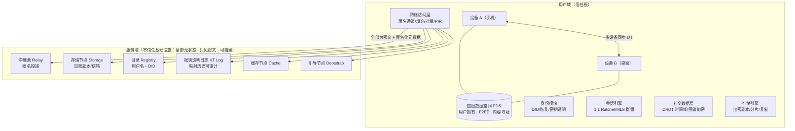

### 2.2 分层职责

| 层 | 职责 | 关键技术 |
| --- | --- | --- |
| L1 身份层 | DID 生成、多设备、恢复、用户名解析、密钥透明性 | 分层密钥、Shamir/门限恢复、KT 日志（Merkle Tree） |
| L2 密码层 | 1:1 会话加密、群组加密、签名 | X3DH + Double Ratchet；MLS (RFC 9420)；Ed25519/X25519 + AEAD |
| L3 数据层 | 用户数据空间（EDS）、CRDT 同步、内容寻址 | 本地 SQLite + 加密 append-only log；CAS（BLAKE3） |
| L4 隐私网络层 | 传输、匿名投递、流量整形、私有检索 | QUIC/TLS、sealed sender（单跳匿名化）、可插拔 mixnet、PIR（演进） |
| L5 应用层 | 会话 UI、时间线、群组治理、设置 | 各平台客户端共享核心库（Rust core + 平台壳） |

### 2.3 服务域节点角色定义

| 节点 | 看到什么 | 不能做什么 | 信任要求 |
| --- | --- | --- | --- |
| Relay（中继池） | 密文包、匿名的入口/出口伪地址、时间 | 不知收发双方真实身份（PBI 封装），不可篡改（AEAD），不可重放（epoch+nonce） | 无 |
| Storage（存储） | 用户数据空间的加密块、访问频次 | 不可解密（密钥在用户域）；不可静默替换（CAS 哈希+签名） | 无 |
| Registry（目录） | 用户名→DID 当前映射、注册时刻 | 不可伪造映射（映射由用户签名 + KT 日志锚定）；不可做登录/鉴权裁决 | 无（作恶可被审计发现） |
| KT Log（透明日志） | 全部映射变更历史 | 不可静默删改历史（append-only Merkle log，客户端交叉核验） | 无（合谋即留下可证明的证据） |
| Cache（缓存） | 公开可寻址内容的密文与签名 | 不可关联读取者（批量取回+缓存层）；不可篡改 | 无 |
| Bootstrap | 网络参数、节点列表 | 无用户数据；仅冷启动寻路 | 无 |

> **设计要点**：服务域没有任何节点能单独完成"读内容、建关系、换密钥"三类攻击中的任何一类；合谋作恶（如 KT 日志+Registry 合谋替换密钥）会被客户端常规核验发现并可公开举证。这就是"零信任基础设施"的可操作定义。

---

## 3. 关键设计决策（ADR）

| # | 决策 | 备选方案 | 选择理由 | 取舍/代价 |
| --- | --- | --- | --- | --- |
| ADR-1 | **1:1 会话采用 Signal 协议族（X3DH + Double Ratchet）** | 自研协议；NaCl box 静态加密 | 前向保密+PCS 经十年实战检验；开源实现成熟（libsignal） | 需要预密钥（prekey）分发机制 → 由 EDS 承载（§5.2） |
| ADR-2 | **群组采用 MLS（RFC 9420）** | 每_pair_独立 ratchet；对称群密钥+手动重发 | 树形 KEM 使成员变更开销 O(log n)，支撑千人级群（FR-6.3）；IETF 标准、多实现 | MLS 依赖"传递安全组消息"的通道 → 复用中继池广播路径 |
| ADR-3 | **不上链。身份映射用"Registry + 密钥透明性日志"实现** | 区块链命名（ENS 式）；纯 DHT 命名 | 链上身份公开可追踪，与 G3 元数据隐私直接冲突；链的性能/费用不满足 IM；KT 日志达到同等的"映射不可静默伪造"保证（SR-5） | KT 日志的全球一致性弱于链，采用"最终一致 + 客户端核验"（§4.4） |
| ADR-4 | **元数据保护分级：默认轻量混淆，增强模式渐进开启** | 默认全量 mixnet | 全网 mixnet 需要规模化流量才有匿名性，冷启动期反而更弱；轻量级（padding+批量+伪地址轮换）成本可控、立即生效 | 强威胁用户需手动开启增强模式（对齐 UX-3 的分级呈现） |
| ADR-5 | **存储采用"本地优先 + 好友互助加密托管"为 P0，存储激励市场为 P2** | 中心化网盘式备份；纯 DHT 复制 | 好友托管无需代币激励即可冷启动；加密副本 + 门限分片保证托管者不可读（SR-1） | 依赖好友在线冗余度 → 默认 2+n 副本 + 擦除编码兜底 |
| ADR-6 | **客户端架构：Rust 核心库 + 平台壳** | 各平台原生全栈 | 密码学正确性只实现一次；协议一致性测试套件覆盖全部客户端（R10 缓解） | UI 层开发效率略降 → 用 FFI + 各平台原生 UI 补偿 |
| ADR-7 | **无全局 Feed。时间线 = 用户自有订阅集合的本地聚合** | 中心化/联邦时间线 | 全局时间线需要全局可读明文索引，与元数据隐私冲突；也规避"平台操纵分发"的权力结构（Non-Goals） | 发现性弱 → 靠显式订阅、群组社区与好友邀请码弥补（§7.5） |
| ADR-8 | **公开可寻址内容 = 公钥可验证签名 + 可选加密，默认可匿名读取** | 无公开内容（纯好友圈） | 保留"开放社交"属性（G7）；读取行为经缓存层批量混入，不关联身份（FR-3.5） | 公开内容可被第三方索引 → 用户按内容粒度自选可见性（FR-4.5） |

---

## 4. 身份与密钥管理设计

### 4.1 分层密钥体系

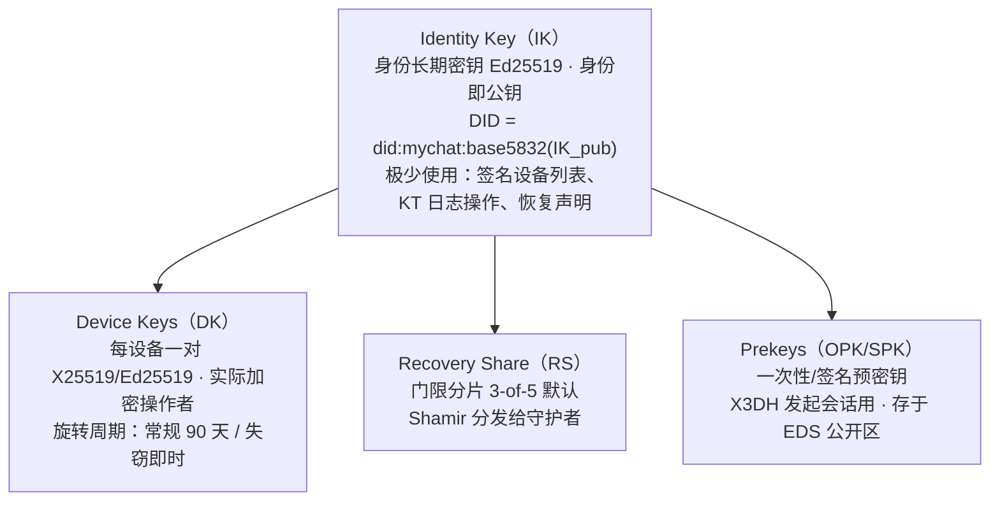

- **DID 生成**：首次启动时，安全随机生成 IK；DID 派生自 IK 公钥（自认证，无需注册机构）。全程无用户操作（FR-1.1 / UX-1）。
- **用户名**（FR-1.2）：用户名是 IK 上的一层**别名**，不是身份本体。Registry 存 `name → DID` 的**用户签名记录**，KT 日志锚定全部历史。用户名可换、可释放，身份不变——解耦"人类可读性"与"密码学身份"，避免 Nostr 式"私钥即身份"的脆弱性。

### 4.2 多设备管理

- 新设备加入：老设备生成**设备凭证（Device Certificate）**，`IK 签名 {DK_pub, 设备描述, 有效期}`；新设备凭证写入 KT 日志，所有联系人客户端自动核验——**联系人无需任何操作**（FR-1.4）。
- 设备吊销：老设备签名吊销记录并更新 KT；其他设备收到 KT 更新后自动轮换与该身份相关的会话密钥（设备粒度的前向安全）。
- 设备间数据同步使用设备对设备的加密通道（DT），历史数据经 EDS 加密副本恢复，新设备不上传任何明文。

### 4.3 社交恢复（对应 FR-1.3 / UX-2）

**设置阶段**

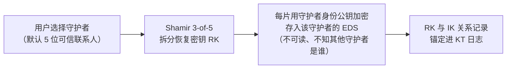

**恢复阶段（新设备）**

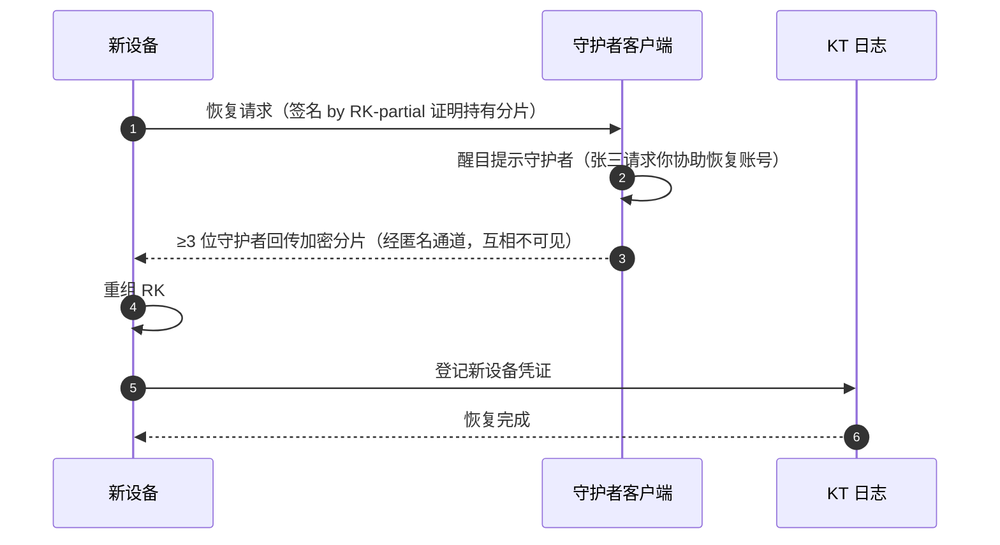

- **对抗守护者合谋**：默认门限 3/5；恢复请求有 **24 小时冷静期**，期间原设备可一键否决并告警（R5 缓解）。
- **隐私**：守护者只见"有人请求恢复"，看不到账号任何内容；网络看不到恢复发生在谁与谁之间（匿名通道）。
- **产品包装**：UI 上称为"**紧急联系人**"，设置流程与微信紧急联系人心智一致；提供"恢复演练"一键模拟（UX-2）。

### 4.4 密钥透明性（KT）日志（对应 FR-1.6 / SR-5）

- 结构：append-only **Merkle 树日志**（CONIKS/SEEMless/Parakeet 思路），叶子为 `DID → {设备密钥集, 用户名记录, 恢复策略}` 的历次版本。
- 客户端常规核验（无感后台进行）：
  - **包含性证明**：我看到的联系人密钥在日志中；
  - **一致性证明**：日志全局唯一且只增不改（相邻 snapshot 链接）；
  - **监视代理**：可选第三方监视者（或用户自己的多设备互为监视者）发现"我的密钥被替换"。
- 冷启动一致性：多个独立运营的 KT 副本（gossip 链接彼此根哈希），Registry 与 KT 由不同主体运营为默认，制造合谋成本；任何映射替换必须留下日志记录——**攻击从"静默"变为"可举证"**（SR-5 达成）。

---

## 5. 隐私保护通信设计

### 5.1 消息投递总览（对应 FR-3.1 / FR-5.1 / SR-2）

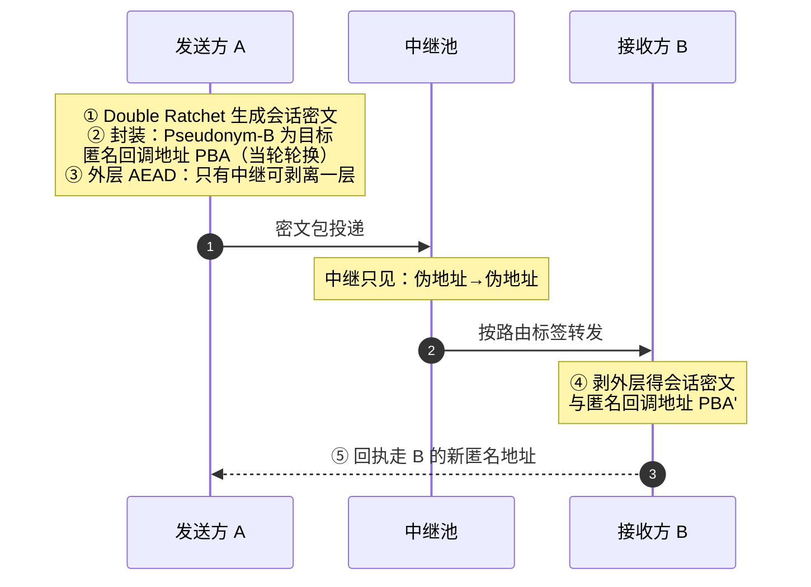

- **Pseudonym 信封（sealed sender 的去中心化版）**：真实地址（DID 的存储位置索引）被加密在信封内，只有接收方能解开；中继只看到**当轮伪地址**。伪地址由收发双方共享密钥 + epoch 派生，**每会话每 epoch 轮换**，中继侧无法跨 epoch 关联。
- **重放/注入防护**：信封带 epoch+序号，接收端拒重放；发送端签名（内层）保认证（SR-4）。
- **演进路径（ADR-4 分级）**：
  - Level 0（默认）：伪地址 + 恒定填充档位（256B/1KB/16KB/128KB 四档）+ 批量出站（定时器抖动 ±20%）；
  - Level 1（增强）：接入单混合节点层（中继池启用 mix 模式，延迟 +0.5–2s），打破收发时序相关性；
  - Level 2（强）：可插拔 mixnet（Loopix 类 PoW 无关的低延迟混合网络），面向 Persona B 场景（FR-3.6）。

### 5.2 1:1 会话建立（X3DH 适配去中心化）

Signal 协议的目录服务（prekey server）在本设计中替换为 **EDS 公开区**：

- 用户的 SPK/OPK 预密钥束（bundle）以"任何人可读"的加密外层（实际为明文公钥材料+签名）存放于用户 EDS 的公开区，经 CAS 寻址；
- 发起方通过 Registry 解析 DID → 从 EDS 取 bundle（经缓存节点批量混取，读取行为不关联身份，FR-3.5）→ 验签 → X3DH 握手 → Double Ratchet 会话；
- 预密钥耗尽由设备后台补充，用户无感。

### 5.3 群组加密（MLS）

选型依据见 ADR-2。要点：

- 每个"加密群组"对应一个 MLS Group；成员变更（Epoch 推进）由群权限模型授权（§8.2）；
- MLS Tree 区域：1000 人群组单次成员变更开销 O(log n)（约 10 个 Update 路径），对比两两 ratchet 的 O(n)（FR-6.3 / NFR-3）；
- 群元数据（群名、成员列表、头像、权限表）不进 MLS 消息层，而是作为**群组状态 CRDT** 存于群成员共享的加密数据空间——成员列表对基础设施不可见（FR-6.1 / SR-3）。

### 5.4 离线信箱与推送隐私（FR-5.5 / FR-5.6 / R7）

- 离线信箱：接收方在存储网络中维持一个**信箱空间**（其地址索引仅接收方可解析）；来信密文按信箱分档填充后写入；接收方客户端前台运行时直连拉取 + 后台经匿名回调地址拉取。信箱节点不可读（AEAD）、不可关联（伪地址轮换）、不可测大小（填充档位）。
- 系统推送（APNs/FCM）：仅投递**唤醒令牌**——与 DID 无关联的轮换随机 ID（90 天轮换 + 令牌池）；内容永不经系统通道。应用内常驻通道为默认，系统推送为 iOS 上的节能补充。

### 5.5 私有发现与检索（FR-3.4 / FR-3.5）

- 通讯录匹配：客户端对手机号做 `HMAC(盐, 号码)` 后提交布隆过滤器交集协议（PSI 的简化形态），服务端无法还原号码，无法知道"谁在找谁"（只返回"命中集合"的加密令牌）。
- 时间线取回：关注内容的取回按"缓存节点 → 批量窗口"混入：客户端以固定节奏批量请求 N 条密文块（含噪声填充块），缓存节点无法确定用户实际消费了哪条。PIR 作为 Level 2 演进项。

---

## 6. 数据存储与所有权设计

### 6.1 加密数据空间（EDS, Encrypted Data Space）

每个用户拥有一个**内容寻址的加密数据空间**，这是"数据所有权"的物理载体（G1 / FR-7.1）：

```
EDS = {
  header:  用户 IK 签名的空间清单（版本、密钥指针、副本策略）
  blocks:  内容寻址密文块 (CID = BLAKE3(密文)), AEAD 加密, 密钥分级包裹:
           - 公开区: 任何人可读 (prekey 束, 公开内容密文)
           - 联系人区: 会话密钥可见者可读
           - 私有区: 仅用户自己 (图谱、设置、草稿、缓存索引)
}
```

- **本地权威**：设备上的 EDS 全量副本是权威；网络副本仅用于多设备与容灾。
- **密钥层级**：空间主密钥（MK，由用户口令+硬件密钥库包裹，或由 RK 承载）→ 区密钥 → 块密钥。轮换只动上层，历史块不重加密。
- **写路径**：本地写入 → CAS 入块 → 追加到本地加密 log → 异步复制到托管集合。
- **读路径（他人读我）**：按内容的授权能力（包裹给对方公钥的块密钥）解密对应块；CAS 完整性由哈希保证，作者性由内层签名保证。

### 6.2 托管与容灾（ADR-5，FR-7.3）

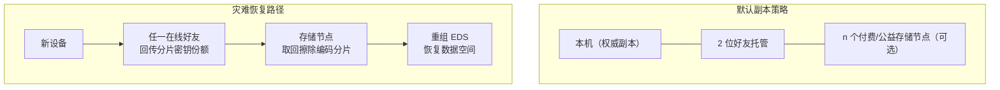

托管内容为 EDS 密文块经擦除编码（2+3）分片，每片用门限方案再加密（好友 A 持有分片密钥份额之一）；好友全程不可读内容，互相不知道对方也是托管者。

- 托管选择不要求用户理解密码学：UI 为"选择 2 位紧急联系人帮你保存一份加密备份"（UX-2 心智一致）。
- 存储节点（v1 为社区公益节点 + 自托管；v2 引入激励市场）：只验证存储委托票据（签名），按时效与配额管理，无内容知识。

### 6.3 删除与注销（FR-4.4 / FR-7.4 / SR-9）

- 逻辑删除：吊销块密钥能力 + 广播删除墓碑（tombstone）→ 托管节点按策略回收块；诚实但好奇节点在回收前仍持密文（无法解密）。
- **边界诚实**（P7/UX-7）：UI 明示"已送达对方的副本无法远程销毁；网络中的密文将在副本周期内回收"。
- 注销：销毁全部密钥 → KT 日志登记注销（DID 停用，不可复用以防冒名）→ 空间墓碑化。孤儿密文不可解密，隐私等价于删除。

---

## 7. 社交功能模块设计

### 7.1 模块地图（对应需求 §5.0）

| 模块 | 依赖的底层能力 | 对应需求 |
| --- | --- | --- |
| 联系人 | 身份层（DID/用户名解析）、X3DH | FR-8.1 |
| 会话（1:1） | Double Ratchet、匿名投递、离线信箱 | FR-5.x |
| 时间线/动态 | EDS、CRDT 时间线、可见性加密 | FR-4.1–4.6 |
| 群组 | MLS、群组状态 CRDT | FR-6.x |
| 通知 | 唤醒令牌、信箱 | FR-5.6 |
| 发现 | PSI 匹配、缓存混取 | FR-3.4/3.5, FR-8.1 |
| 治理 | WoT 声誉、群组权限 | FR-8.x, FR-6.5 |
| 数据面板 | EDS 导出、托管管理 | FR-7.x, UX-6 |

### 7.2 关注关系（加密图谱，FR-3.2 / SR-3）

- 关注动作 = 我把"我的动态加密密钥（按接收方轮换的 leaf key）"包裹给被关注方 + 在**我的私有区**记录关注条目（对方名不见于此）。
- 被关注方获得能力后，把我加入**其私有区**的"关注中"列表。
- 图谱数据双端对称私有，任何节点只见加密块；取关/屏蔽 = 能力吊销 + 墓碑。
- **无中心可查的粉丝数**：公开可寻址内容（FR-4.5）的签名聚合数可作可选的公开影响力信号；好友圈内容不产生公开计数——这是与中心化平台的刻意差异，抑制追热点式图谱竞赛。

### 7.3 动态与互动（FR-4.1–4.4）

- 发布：客户端生成内容密钥 CK → 按可见性集合（联系人/分组）分别包裹 CK → 密文入 EDS → 授权集合内成员的客户端按能力取回解密。
- 互动（赞/评/转）：互动事件是**发布到该可见性集合的微型内容**，同等加密粒度；评论线程为集合内 CRDT 树。
- 转发 = 引用 + 重新授权；超范围转发在客户端尽力拦截（水印 + 能力边界提示），但如实披露无法物理阻止收件人拍照外传。

### 7.4 时间线（ADR-7，FR-4.2）

- 本地聚合：设备维护"关注中"集合 → 各自 EDS 增量 log → 本地按时间归并 → 离线可刷（本地缓存）。
- 同步节奏：后台低频增量 + 打开时前台快速增量；取回经缓存混取（§5.5）。
- 排序：v1 仅按时间 + 置顶；**无算法推荐**（Non-Goals），设置中提供"只看未读/按分组过滤"等确定性工具。

### 7.5 发现与冷启动（R2 缓解）

- 添加好友：用户名精确搜索（Registry）、二维码/近场、通讯录 PSI 匹配（§5.5）、好友邀请链接（带一次性能力令牌）。
- 单人价值：EDS 本身是带加密备份的私人数据库（日记、收藏、文件），不依赖好友网络也有留存价值——对冲冷启动期"空网络"问题。
- 社区发现：公开群组/频道可通过成员邀请码与（P2）主题聚合页发现；聚合页只列"群组自声明的元数据+成员数下界"，不暴露成员身份。

---

## 8. 群组系统设计

### 8.1 群组形态

| 形态 | 规模 | 加密 | 成员可见性 | 典型场景 |
| --- | --- | --- | --- | --- |
| 私密群 | 3–50 | MLS | 仅群内 | 亲友、同事小群（对标微信群） |
| 大私密群 | 50–2000 | MLS | 仅群内 | 社区、兴趣组织（Persona C） |
| 公开频道 | 无上界 | 内容密钥公开挂出、可匿名读 | 成员关系半公开 | 公告、媒体订阅（对标频道） |

### 8.2 群组权限模型

```
GroupState (CRDT, 群加密空间内):
  members[]: DID + 角色 (owner / admin / writer / reader)
  policy: { join: invite|apply, history: full|new-only, post: roles[], maxMember }
  audit[]: 治理事件日志 (成员变更/权限变更/公告) —— 群内可审计
```

- **加入即前向隔离**（FR-6.2）：MLS epoch 推进使新成员读不到历史（`history: new-only` 默认）；`full` 模式由管理员显式选择并提示风险。
- **移除即断读**：移除成员触发 MLS Commit，其 leaf 被剔除，立即无法解密后续消息。
- **权限变更审计**：全部治理事件入 `audit[]`，成员客户端可回放验证——群主权力的行使是可审计的（FR-6.5）。

### 8.3 大群组性能设计（NFR-3）

- 消息分发：MLS 密文消息（较小）经中继池扇出；大附件走 EDS 内容寻址 + 缓存节点（一次上传、缓存分发），群规模增大不增加发送方带宽（FR-6.3）。
- 成员变更风暴治理：批量 Commit 窗口（如 3 秒合并），保护树高与消息洪峰。

---

## 9. 反滥用与治理设计

无中心审核是产品立场（P1），因此治理必须是**密码学成本 + 声誉 + 客户端自治**的组合（FR-8.x / SR-8）：

| 机制 | 作用 | 说明 |
| --- | --- | --- |
| 准入成本 | 反 Sybil | 陌生首信要求发送方附 PoW 令牌（自适应难度）或持有"邀请背书"（被 ≥1 位已有声誉用户签名引用）；成本参数全网可调 |
| Web of Trust 声誉 | 垃圾评分 | 客户端本地计算：基于我与联系人的信任图对陌生 DID 的距离加权声誉；无中心黑名单、无全局画像 |
| 用户自治 | 骚扰抑制 | 屏蔽（能力吊销）、会话级过滤规则、陌生消息折叠 |
| 群组治理 | 社区秩序 | 角色权限、审批、禁言、投票踢人（audit 可审计） |
| 本地内容安全 | 诈骗/NSFW | 端上模型可选开启，特征不上传（FR-8.5） |
| 红队运营 | 持续评估 | 上线前红队对抗评估；线上蜜罐身份度量垃圾到达率（护栏指标） |

---

## 10. 客户端与交互设计

### 10.1 技术形态

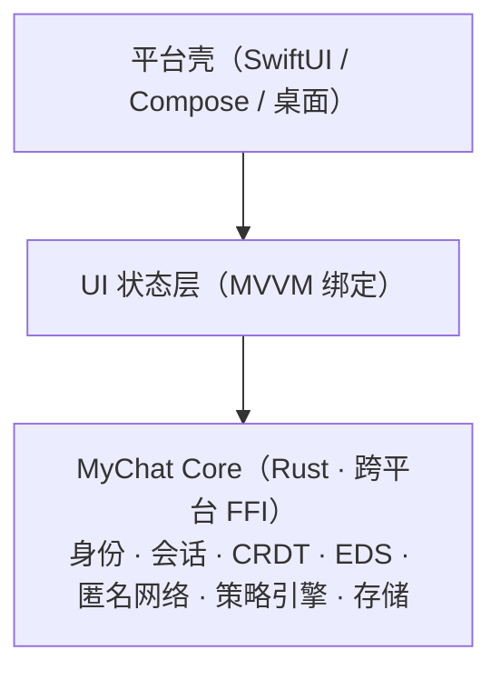

密码学与协议逻辑**只实现一次**（ADR-6），一致性测试套件对 Core 生成跨平台同构行为，降低 R10。

### 10.2 信息架构（移动端）

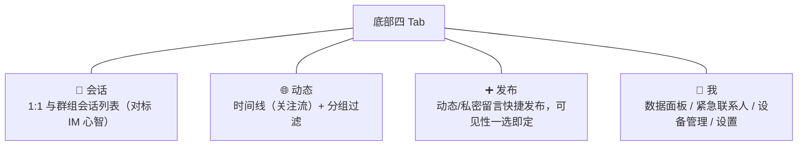

会话内：文本/图片/语音/文件/位置/引用回复/撤回编辑/已读开关。

### 10.3 关键流程设计（UX-1/UX-2/UX-3 落地）

**首次启动（目标 ≤5 分钟到第一条加密消息）**

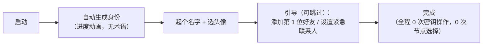

**设置紧急联系人（社交恢复）**

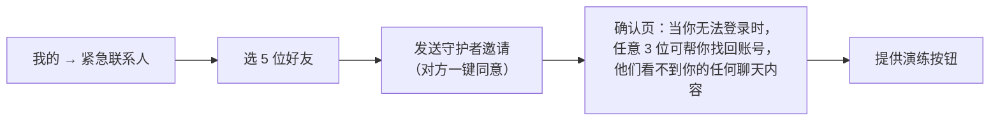

**异常显形（UX-3）**

- 联系人设备变更：会话顶部轻提示"小林在新设备上登录 · 查看详情"，详情页给出验证选项（当面扫码 / 比对安全表情），**不阻断**但可一键要求重验证。
- KT 日志检测到异常替换：全屏级告警 + 建议线下核实——仅此场景使用强打扰。

**数据面板（UX-6，所有权的可感知）**

```
我的数据:  本机占用 | 云端加密副本 xN (托管者: 王五、赵六)
          导出全部数据(一键) | 更换托管者 | 立即删除账号
能力边界说明: 简明披露删除与匿名的真实边界 (UX-7)
```

### 10.4 通知与打扰控制

- 通知分级（联系人/群组/陌生人折叠）、免打扰、会话级已读开关（关闭时不产生可分析的状态差异消息）。

---

## 11. 协议与数据模型

### 11.1 协议分层与消息封装

```
Envelope (中继可见层):
  { version, epoch, route_tag, pseudonym_from, pseudonym_to, pad_class, nonce, payload* }
  payload* = AEAD(K_epoch, Inner) —— 中继可路由不可读

Inner (端到端层, 双方/群成员可见):
  { type: msg|receipt|commit|prekey|social_event|tombstone,
    sender_did, sig(Ed25519), ts_bucket(时间桶化, 如 1min), body }
  body 视 type 为 Double Ratchet 密文 / MLS 密文 / 明文公钥材料(仅 prekey 类)
```

- **时间桶化**：协议层把时间戳舍入到桶（默认 1 分钟），抑制精确时序关联（FR-3.3）。
- **版本与套件协商**：Envelope.version + 密码套件 ID；客户端维护双版本兼容窗口（NFR-10）。

### 11.2 核心数据模型（概念级）

```
DID            = base58(IK_pub)
Device         = { did, dk_pub, cert(IK签名), revoked_at?, added_at }
UserNameRecord = { name, did, sig(IK), kt_index }
EDSBlock       = { cid = H(ciphertext), ciphertext, refs[], class: public|contact|private }
EDSLog         = append-only { op: put|del|grant|revoke, cid, key_wrap, sig(IK/DK) }
TimelineItem   = { cid, author_did, visibility_set, body_ref, interact_refs[] }
Group          = { group_id(随机), mls_group, state: GroupState(CRDT), eds_ref }
Session        = { peer_did, ratchet_state, verified_state, per-epoch pseudonyms }
Contact        = { did, user_name, groups[], trust: {verified_at, method}, muted? }
```

### 11.3 关键时序

**加好友（面对面扫码）**

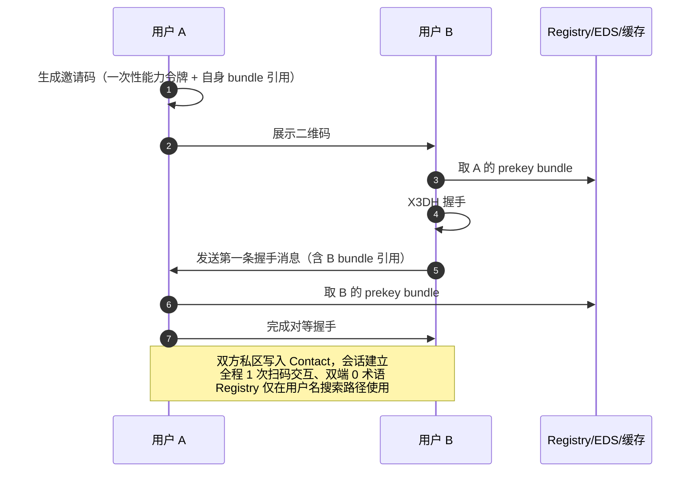

---

## 12. 性能与容量设计

| 场景 | 预算 | 设计手段 |
| --- | --- | --- |
| 在线私聊延迟（NFR-1: P50<1s） | 加解密 <10ms；中继两跳 <200ms；Level0 混淆批处理窗口默认关闭（仅离线信箱/通知用批处理），实时消息直投 | 实时/信箱双通道分离 |
| 冷启动到时间线（NFR-2: <3s） | 本地缓存即显 + 后台增量；EDS log 索引（BLAKE3 树）毫秒级定位 | 本地优先 |
| 1000 人群消息（NFR-3: P95<10s） | MLS 密文 O(log n) 变更；附件走 CAS+缓存扇出；批量 Commit | §8.3 |
| 元数据开销（NFR-11: ≤3×） | 填充四档位平均膨胀 ~1.6×；伪地址轮换复用连接（QUIC 多路复用） | 分级模式（ADR-4） |
| 客户端资源 | 常驻内存 <150MB；待机电量与主流 IM 差 ≤10%（应用内通道自适应心跳） | 平台通道策略（FR-5.6） |
| 网络规模 | 中继无状态水平扩展；存储按 EDS 分片；目标 1 万节点/百万身份为 v1 设计上限 | 服务域全部无状态化 |

---

## 13. 安全设计复查

需求报告 §7.2 的每条安全需求在本设计中的落点：

| 安全需求 | 设计落点 | 残余风险与声明 |
| --- | --- | --- |
| SR-1 内容机密性 | Double Ratchet / MLS / EDS 分区加密（§5, §6.1） | 端点被攻破不在模型内（7.1） |
| SR-2 关系机密性 | Pseudonym 信封 + epoch 轮换 + 填充/批处理/时间桶（§5.1/5.4/11.1） | Level0 可对抗被动中继合谋；时序分析需 Level1/2（ADR-4，产品如实分级披露） |
| SR-3 图谱机密性 | 图谱双端私有区存储 + 能力吊销（§7.2, §6.1） | — |
| SR-4 认证与完整性 | 内层 Ed25519 签名 + AEAD + epoch 防重放（§5.1） | — |
| SR-5 映射可验证 | 用户签名记录 + KT Merkle 日志 + 多副本交叉核验（§4.4） | 映射替换从"静默"降为"可举证"；冷启动期副本少时核验频率提高 |
| SR-6 FS/PCS | Double Ratchet / MLS epoch；设备吊销触发会话轮换（§4.2/5.1） | — |
| SR-7 可恢复性 | 社交恢复（Shamir + 冷静期）+ 好友托管副本（§4.3/6.2） | 守护者合谋≥门限可恢复（by design，可否决窗口缓解） |
| SR-8 反滥用 | PoW/邀请背书 + WoT 本地声誉 + 群治理（§9） | 无中心审核下不可能清零，护栏指标监控（蜜罐到达率） |
| SR-9 可删除性 | 能力吊销 + 墓碑 + 诚实披露（§6.3） | 物理不可删除（固有边界，UX-7 披露） |
| SR-10 无单点信任 | 服务域全角色零信任化（§2.3）+ 开源 + 审计（NFR-14） | Bootstrap 节点仅提供公共参数，无用户数据 |

**加密算法基线**：X25519 / Ed25519 / HKDF-SHA-256 / AES-256-GCM（或 ChaCha20-Poly1305）/ BLAKE3 / MLS-128 (HPKE X25519+HKDF+AES-GCM)。全部使用经审计的标准实现，禁止自研密码学（R4 缓解）。

---

## 14. 里程碑与路线图

```mermaid
timeline
    title MyChat 里程碑与路线图
    section M0 协议原型（第 1–2 月）
        Rust Core：身份 / X3DH / EDS / 直连投递（无混淆）
        两台设备端到端加密私聊 Demo
        产出协议规范 v0.1 与一致性测试框架雏形
    section M1 MVP（第 3–5 月，对应需求 P0 全集）
        1:1 会话（实时 + 离线信箱）与 Level0 元数据混淆
        私密群（≤50，MLS）/ 动态 + 时间线 + 互动 / 用户名 + KT 日志
        社交恢复（冷静期）/ 多设备 / 好友托管副本
        三个平台客户端（iOS / Android / 桌面）
        Gate：需求 §11.1 的安全门/隐私门/体验门/恢复门/性能门全部通过
    section M2 V1 公测（第 6–8 月）
        大群组（≤2000）与群治理 / 公开频道（匿名可读）
        Level1 增强元数据模式 / PSI 通讯录匹配 / WoT 声誉 + 准入成本
        数据导出 / 桌面全功能 / 外部安全审计与公开报告
        Gate：北极星与护栏指标体系上线（§15）
    section M3 演进（第 9 月起）
        Level2：mixnet 接入 / PIR 检索 / 语音视频通话
        存储激励市场 / 第三方客户端认证计划 / 协议 v1 冻结
```

### 团队分工建议（M1 期，约 8–10 人）

核心密码学与协议 2 · Rust Core/网络 2–3 · 客户端 3（iOS/Android/桌面）· 产品设计 1 · 测试与安全工程 1。

---

## 15. 度量与验收对照

| 需求报告度量（§11.2） | 设计中的实现与埋点 |
| --- | --- |
| 北极星：周加密互动 ≥3 次用户占比 >60% | Core 记录本地互动计数（隐私：仅端上聚合、差分上报，不上传个体序列） |
| 首次加密互动 <3 分钟 | 首启流程漏斗（端上事件，经匿名聚合通道上报） |
| 社交恢复设置率 >60%（30 日） | 守护者设置漏斗 |
| 元数据保护开启率 100% | 架构保证：内容加密与 Level0 混淆无关闭开关；增强模式打开率为加分项 |
| 蜜罐垃圾到达率 | 反滥用护栏（§9 红队运营） |
| 第三方节点 ≥5 | Bootstrap/Registry/KT 多运营方计划 |

---

## 16. 开放问题

| # | 问题 | 现状 | 计划 |
| --- | --- | --- | --- |
| Q1 | Level0 混淆对"设备端被动流量观察者"的保护边界 | 可抗中继合谋，不承诺抗本地 ISP 全量分析 | M2 评估 Level1 默认化的成本曲线 |
| Q2 | KT 日志冷启动期的副本多样性与核验强度 | 双运营方为默认目标，早期由项目方+社区节点组成 | M1 结束时引入至少 1 个独立第三方副本 |
| Q3 | 好友托管在社交密度低用户上的冗余不足 | 默认 2+n+擦除编码 | M2 评估公益存储节点配额；P2 引入激励 |
| Q4 | WoT 声誉的冷启动公平性（新用户无声誉） | 邀请背书缓解 | 参数随蜜罐数据迭代；防"声誉贷"机制待研究 |
| Q5 | 公开频道的内容发现与生态膨胀的平衡 | v1 仅邀请码+聚合页雏形 | M3 引入主题聚合，坚持无算法推荐（Non-Goals） |
| Q6 | 多司法辖区对 E2EE 与 KT 日志的合规细节 | 架构性立场已定（无后门位置） | 法务按辖区持续评估，政策页动态披露 |

---

*本报告基于[需求分析报告](./需求分析报告.md)（v1.0）完成，二者共同构成 MyChat 项目的需求与设计基线。后续协议规范、密码学规格说明书与各客户端设计稿将作为本文档的子文档另行产出。*
