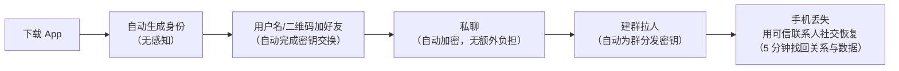
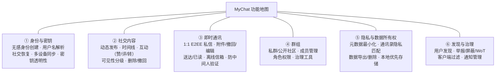

# MyChat（去中心化安全社交网络）需求分析报告

| 项目名称 | MyChat —— 去中心化安全社交网络（Decentralized Secure Social Network） |
| --- | --- |
| 文档类型 | 需求分析报告（Software Requirements Specification） |
| 版本 | v1.0 |
| 日期 | 2026-10-29 |
| 状态 | 初稿（供评审） |
| 关联文档 | [产品设计报告](./产品设计报告.md) |

## 修订记录

| 版本 | 日期 | 修订人 | 修订说明 |
| --- | --- | --- | --- |
| v1.0 | 2026-10-29 | 产品组 | 首个完整版本 |
| v1.1 | 2026-10-31 | 产品组 | 项目由 DSSN 更名为 MyChat，产品定位不变 |

---

## 目录

1. [项目概述](#1-项目概述)
2. [市场与现状分析](#2-市场与现状分析)
3. [目标用户与用户画像](#3-目标用户与用户画像)
4. [用户场景与用户故事](#4-用户场景与用户故事)
5. [功能需求](#5-功能需求)
6. [非功能需求](#6-非功能需求)
7. [威胁模型与安全需求](#7-威胁模型与安全需求)
8. [用户体验与可用性需求](#8-用户体验与可用性需求)
9. [约束、假设与依赖](#9-约束假设与依赖)
10. [风险分析](#10-风险分析)
11. [验收标准与成功度量](#11-验收标准与成功度量)
12. [附录](#12-附录)

---

## 1. 项目概述

### 1.1 背景

互联网造就了 Facebook、微博等大型社交平台。这些由中心化组织控制的平台聚集了数以亿计的用户，通过对平台内容的生产、传播和分享赚取高额利润。然而，这种中心化结构对用户存在根本性的问题：

1. **数据所有权缺失**：用户的社交数据（关系链、内容、行为记录）存储在平台方控制的系统中，账号可以被单方面封禁，数据可以被单方面删除或带走，用户对自己的数字身份与社交资产没有真正的所有权。
2. **隐私滥用**：平台可以不经用户许可，自由地使用、分析、交易用户数据。Facebook–Cambridge Analytica 事件、各类平台内部"数据滥用"丑闻反复证明了这一结构性风险。平台商业模式（精准广告）与用户隐私利益存在根本冲突。
3. **单点故障与审查**：中心化服务是单点故障源，也使大规模监控与审查在技术上成为可能。
4. **元数据泄露**：即使内容被加密，"谁在什么时间和谁交流、交流频率与规模如何"这类元数据在中心化架构下天然暴露给平台方，而元数据往往比内容本身更能刻画一个人。

**去中心化**因此成为社交网络的重要发展趋势：让用户完全拥有自己数据的所有权。然而现有去中心化社交网络工作仍存在明显局限：

- **联邦式方案（Mastodon 等）**：内容分发分散到多个实例（instance），缓解了单一中心的问题，但用户仍然必须选择并信任某个第三方节点——实例管理员可以看到未加密的推文、关系链与元数据，实例之间的联邦协议本身也不提供端到端保密。本质上是"把信任从一个大中心转移到若干个小中心"，而非消除信任。
- **加密通讯方案（Signal 等）**：提供了优秀的端到端加密与密封发送者（sealed sender），但其账号体系、目录服务与推送依赖中心化服务器，且不具备公开社交（Feed、关注、群组社区）能力。
- **完全 P2P / 区块链方案（Secure Scuttlebutt、Nostr、Farcaster 等）**：要么在元数据保护、垃圾治理、密钥恢复方面有重大缺口，要么把易用性完全让渡给了技术理想主义（用户需要保管助记词、理解节点同步），无法被普通用户接受。

### 1.2 问题陈述

> **如何设计一个社交网络，使用户在不需要信任任何第三方节点的前提下，完全拥有自己数据的所有权；同时其安全是"用户友好的"——用户无需理解密码学即可获得与中心化平台相当的使用便利？**

需要强调的是：本项目的关键不仅仅是**数据上的安全**——利用公钥加密算法对内容进行保密并不难实现——而是**用户友好的安全（user-friendly security）**。历史上大量安全产品（PGP 邮件加密等）证明了：如果安全的使用成本超过普通用户的耐心，安全就不会被使用。MyChat 的核心命题是**既要、又要**：既拥有中心化社交网络中习惯的便利，又保持网络的安全与开放。

### 1.3 项目目标

| 编号 | 目标 | 衡量方式 |
| --- | --- | --- |
| G1 | 数据所有权 | 用户数据（身份、关系链、内容）完全由用户设备与用户控制的密钥所决定；任何第三方节点均无法读取明文或冒充用户 |
| G2 | 保密性 | 1:1 私信、群组消息、私密内容端到端加密；存储/中继节点只接触密文 |
| G3 | 元数据隐私 | 对网络层对手与存储节点，隐藏通信关系图（谁和谁通信）、时间模式与社交图谱 |
| G4 | 即时性 | 私信与通知端到端延迟达到主流 IM 水准（秒级） |
| G5 | 群组能力 | 支持从小型私群到千人级公开社区的可扩展群组通信 |
| G6 | 用户友好的安全 | 新用户从安装到完成首次加密社交互动 ≤ 5 分钟、无需阅读任何密钥管理说明；密钥丢失可通过社交恢复找回 |
| G7 | 开放与互操作 | 协议开源、可自建节点/客户端，无单一机构控制 |

### 1.4 术语定义

| 术语 | 定义 |
| --- | --- |
| MyChat | 本项目名称，一款去中心化安全社交网络产品 |
| DSSN | Decentralized Secure Social Network，去中心化安全社交网络，本项目的产品定位（沿用需求背景中的概念名） |
| E2EE | End-to-End Encryption，端到端加密：只有收发双方（或群组成员）能解密内容 |
| 元数据（Metadata） | 关于通信的数据：通信双方、时间、频率、消息长度、社交图谱等 |
| 威胁模型（Threat Model） | 对对手能力与目标的假设集合 |
| DID | Decentralized Identifier，去中心化身份标识符 |
| DHT | Distributed Hash Table，分布式哈希表 |
| Mixnet | 混合网络，通过多跳中继、搅乱与填充隐藏通信关系的匿名通信网络 |
| Sealed Sender | 密封发送者：中继服务器无法得知消息发送者身份的机制 |
| Social Recovery | 社交恢复：通过可信联系人协助恢复密钥/账号的机制 |
| Key Transparency | 密钥透明性：可公开审计的"身份→密钥"映射日志，防止静默替换密钥 |
| MLS | Messaging Layer Security（RFC 9420），可扩展的群组消息加密协议 |
| CRDT | Conflict-free Replicated Data Type，无冲突复制数据类型，用于去中心化数据同步 |
| PIR | Private Information Retrieval，私有信息检索：服务器不知道用户检索了什么 |
| Persona | 用户画像，典型目标用户的抽象代表 |

---

## 2. 市场与现状分析

### 2.1 问题现状：三类方案的系统性缺口

下表从 MyChat 关注的六个关键维度对现有代表性方案进行对比：

| 维度 | 中心化平台 (Facebook/微博/微信) | 联邦式 (Mastodon) | 加密 IM (Signal) | P2P/区块链 (SSB/Nostr/Farcaster) | **MyChat 目标** |
| --- | --- | --- | --- | --- | --- |
| 数据所有权 | ✗ 平台控制 | △ 实例控制 | ✗ 服务器控制（账号可被吊销） | ◊ 部分（Nostr 中继可弃发；SSB 无法删除） | ✓ 用户完全控制 |
| 内容保密性 | ✗（平台可见） | ✗（实例可见） | ✓ | △（Nostr 默认明文） | ✓ E2EE 全覆盖 |
| 元数据隐私 | ✗ 平台全知 | ✗ 实例可见 | △ 有 sealed sender，但依赖中心目录 | ✗ 多数无防护 | ✓ 无需信任任何节点 |
| 需要信任的第三方 | 单一大平台 | 实例管理员 | Signal 服务器 | 中继/索引服务 | **无（信任最小化）** |
| 易用性 | ✓ 极佳 | △ 需选实例 | △ 手机号注册 | ✗ 助记词/同步/发现困难 | ✓ **与中心化相当** |
| 群组/公开社交 | ✓ 完整 | ✓ 完整但无加密 | △ 仅加密群聊（有上限） | △ 功能残缺 | ✓ 加密且可扩展 |

### 2.2 逐项局限分析

**（1）Mastodon / Fediverse（联邦式）**
- 用户必须选择并信任某个实例：实例明文存储所有本地用户的推文、转发、点赞与关注关系；
- 跨实例交互时，用户的活动痕迹会扩散到远端实例，信任边界不可控；
- 账号绑定实例域名，迁移成本高（账号可迁移但历史与关系完整性受限）；
- 无端到端加密（其"加密私信"仅为传输加密，实例可见明文）。

**（2）Signal**
- 加密协议业界标杆（X3DH + Double Ratchet + sealed sender），但组织架构是中心化的：账号注册依赖手机号（暴露身份），目录服务、密钥透明性日志、推送均由单一实体运营；
- 无公开社交能力：没有 Feed、关注、公开内容分发；
- 群组规模受限（官方上限 1000 人），无社区形态。

**（3）Secure Scuttlebutt（SSB）**
- Gossip 复制模型新颖，但：所有历史不可删除（与"被遗忘权"冲突）、无元数据保护（关注关系随 feed 明文传播）、无法防止 Sybil 垃圾、新用户上手门槛高（需要"邀请码"加入 pub 服务器——又引入了对 pub 的信任）。

**（4）Nostr**
- 协议极简（事件 + 中继），但：中继可任意审查/丢弃事件且用户需自行选择中继（与 Mastodon 同构的信任问题）；事件默认明文广播；NIP-05 身份验证依赖 Web 域名（中心化）；私钥即一切，丢失即失去身份。

**（5）Farcaster / Lens 等区块链社交**
- 身份上链带来一定所有权属性，但：内容实际存储在链下（IPFS/中心化 hub），"所有权"打折；链上身份使所有社交行为可被永久、公开地追踪——元数据隐私为负；交易成本与性能限制实时通讯。

### 2.3 差距分析结论

现有方案在以下三处存在**共同的结构性缺口**，这构成 MyChat 的产品机会：

1. **信任最小化 + 高易用性无法兼得**：凡是要用户"选一个节点信任"的方案，都只是搬移了信任，没有消除信任；凡是不需要信任节点的方案，都把复杂度甩给了用户。
2. **元数据隐私被普遍忽略**：内容加密已被广泛实现，但社交图谱、通信关系、活跃模式等元数据在几乎所有方案中对节点方可见。元数据不可通过"事后删除"补救，必须在架构层保护。
3. **密钥管理与社交功能的割裂**：加密 IM 没有社交生态，社交协议没有可用的密钥管理（恢复、多设备、防替换）。"用户友好的安全"要求把密码学正确性地工程化进产品的每一个流程里，而不是做成可选开关。

---

## 3. 目标用户与用户画像

### 3.1 目标市场分层

- **主要市场（P0）**：隐私意识较强、但并非技术专家的普通社交用户——愿意为"数据属于自己"换一个 App，但绝不接受任何额外操作复杂度。
- **次要市场（P1）**：记者、律师、研究人员、活动组织者等对保密性与元数据保护有职业需求的群体。
- **长尾市场（P2）**：需要抗审查、社区自治的群体；希望自托管基础设施的开发者与极客。

### 3.2 用户画像

**Persona A — 小林（24 岁，研究生，普通社交用户）**
- 特征：微信 + 小红书重度用户；听说过隐私泄露新闻，会抱怨"被窃听"，但不会为此做任何复杂配置；手机丢失过一次，深知"账号找不回"的恐惧。
- 核心诉求："像微信一样能用"：扫码/用户名加好友、秒级消息、群聊、朋友圈式时间线。
- 失败红线：让她配置任何密钥、备份助记词、选择节点的流程 = 产品失败。

**Persona B — 陈记者（35 岁，调查记者）**
- 特征：保护信源是职业生命线；当前使用 Signal + 备用机；担心的不只是内容被看，还有"我和谁联系"这一事实本身被监控。
- 核心诉求：元数据隐私、可验证的身份密钥（防止中间人替换密钥诱导其信源）、紧急时最小化痕迹。
- 失败红线：任何对中心化目录/推送服务的依赖都可能成为其信源被分析的入口。

**Persona C — 老王（41 岁，开源社区组织者，管理 2000 人社区）**
- 特征：运营大型群组与公告频道；需要管理员工具、公告、文件分享；对平台的封号与审查规则不满。
- 核心诉求：千人级群组的性能与治理工具（权限、审核、反垃圾），成员数据不被平台收割。

**Persona D — 小张（28 岁，开发者/自托管爱好者）**
- 特征：自己跑 NAS 与各种自托管服务；愿意贡献基础设施；关注协议开放性与可审计性。
- 核心诉求：开源协议、可自建节点参与网络、API/客户端可扩展；是网络早期供给端的种子用户。

### 3.3 反画像（Not our user）

- 期待匿名从事违法活动并要求产品提供绝对匿名保证的用户——MyChat 保护隐私与元数据，但不承诺对抗司法协助的绝对匿名，产品内将明确披露。
- 完全不在乎数据归属、且对换 App 有零容忍的用户——早期不作为目标，通过体验口碑逐步转化。

---

## 4. 用户场景与用户故事

### 4.1 核心用户旅程（Persona A 视角）

对照：在传统加密产品中，该旅程在第三步"备份你的密钥/助记词"处断裂率极高；在 Mastodon 中，旅程在第一步"选择一个实例"处就要求用户做出其无法理解的信任决策。MyChat 的旅程中不存在任何"用户必须理解密码学"的环节。

### 4.2 Epic 与用户故事

#### Epic 1：身份与账户（US-1xx）

| ID | 用户故事 | 验收要点 |
| --- | --- | --- |
| US-101 | 作为新用户，我希望打开 App 即自动拥有一个全局唯一的身份，以便无需理解密钥就能开始使用。 | 无手工生成/备份密钥步骤；身份创建 < 10 秒 |
| US-102 | 作为用户，我希望拥有一个人类可读的唯一用户名，以便朋友能找到我。 | 用户名全局唯一、可解析到身份密钥；解析结果可验证、不可伪造 |
| US-103 | 作为用户，我希望丢失设备后能通过我预先指定的几位可信联系人找回账号，以免永久失去社交关系。 | 恢复成功且不泄露"谁帮谁恢复了"给无关方；恶意联系人单独无法恢复 |
| US-104 | 作为多设备用户，我希望在手机与电脑间同步全部会话与历史。 | 新设备加入不重置他人会话；旧设备可远程吊销 |
| US-105 | 作为用户，我希望我能导出我的全部数据并带走，以证明数据属于我。 | 一键导出标准格式、可在另一实例/客户端导入 |

#### Epic 2：社交与内容（US-2xx）

| ID | 用户故事 | 验收要点 |
| --- | --- | --- |
| US-201 | 作为用户，我希望能发布仅好友可见/指定分组可见/公开可寻址的内容，并随时控制其可见性。 | 密文分发粒度到"接收者集合"；撤回后新读者不可得 |
| US-202 | 作为用户，我希望关注我的人能看到我的动态，但任何节点都无法知道我关注了谁。 | 关注列表加密存储于用户自有空间；网络观察者不可见 |
| US-203 | 作为用户，我希望有时间线（关注流）可以刷，体验接近中心化平台。 | 打开 App 到首屏内容可交互 < 2 秒（有本地缓存时即时） |
| US-204 | 作为用户，我希望可以点赞、评论、转发，且互动只对内容可见范围可见。 | 互动事件同样 E2EE；非授权者（含节点）不可见互动图谱 |
| US-205 | 作为用户，我希望能删除我发布的内容，让后来的访问者无法获得它。 | 删除=吊销能力+通知副本持有者删除；诚实但好奇节点不可得 |

#### Epic 3：即时通讯（US-3xx）

| ID | 用户故事 | 验收要点 |
| --- | --- | --- |
| US-301 | 作为用户，我希望私聊消息秒级送达并显示送达/已读，且除我和对方外无人知道我们何时在聊天。 | 端到端延迟 P50 < 1s；中继不可见双方身份与时间相关性 |
| US-302 | 作为用户，我希望支持文字、图片、语音、文件与消息撤回、编辑。 | 附件同样 E2EE；撤回双方一致 |
| US-303 | 作为用户，我希望在对方离线时消息不丢失。 | 离线信箱仅存密文，节点不可读且不可分析（填充/混淆） |
| US-304 | 作为安全敏感用户，我希望能验证对方的身份密钥没有被替换（防中间人）。 | 提供非密码学专家可用的验证方式（如安全二维码/表情比较）；提供透明性日志审计 |

#### Epic 4：群组（US-4xx）

| ID | 用户故事 | 验收要点 |
| --- | --- | --- |
| US-401 | 作为普通用户，我希望建一个 3–50 人的私群，体验与微信群一致。 | 建群/拉人/踢人全流程用户无加密感知；成员变更后前成员立即无法读取新消息 |
| US-402 | 作为组织者，我希望运营 500–2000 人的公开社区（公告+讨论），性能不崩。 | 群组密钥管理复杂度对成员数为对数级（MLS 树结构）；消息分发经内容寻址缓存 |
| US-403 | 作为群主，我希望有角色与权限体系（管理员/公告员/成员），并支持匿名投票等治理工具。 | 权限变更以群组事件记录且可审计 |
| US-404 | 作为被移出群组的用户，我不应能继续读取群内任何新消息。 | 前向保密（对群组而言）；历史消息按策略处理（见 FR-4.4 冲突权衡） |

#### Epic 5：发现与治理（US-5xx）

| ID | 用户故事 | 验收要点 |
| --- | --- | --- |
| US-501 | 作为用户，我希望通过用户名/二维码/通讯录哈希匹配找到朋友。 | 通讯录匹配仅上传加盐哈希，服务方不可还原 |
| US-502 | 作为用户，我希望对垃圾与骚扰内容有举报与屏蔽手段，无需中心审核员。 | 客户端过滤 + Web of Trust 声誉 + 群组级治理策略组合生效 |
| US-503 | 作为家长/普通用户，我希望对公开可寻址内容有客户端侧的可选过滤。 | 过滤在本地进行，不上传任何行为数据 |

---

## 5. 功能需求

> 优先级：P0 = MVP 必须；P1 = V1 重要；P2 = 后续演进。需求编号 FR-x.y.z。

### 5.0 功能总览

### 5.1 身份与密钥管理

- **FR-1.1 (P0) 无感身份创建**：应用首次启动时在本地设备自动生成用户身份密钥对（身份密钥 + 设备密钥分层，见设计报告），全程无需用户操作。
- **FR-1.2 (P0) 用户名注册与解析**：用户可注册全局唯一人类可读用户名；任意客户端可将用户名解析为身份公钥，且解析结果可被验证（解析基础设施不可在不被察觉的情况下伪造映射）。
- **FR-1.3 (P0) 社交恢复**：用户可指定 3–7 位可信联系人作为恢复守护者，采用门限方案（如 3/5）；任一守护者单独无法恢复或破坏账号；恢复过程不向守护者与网络泄露账号内容。
- **FR-1.4 (P0) 多设备**：一个身份可绑定多台设备；任意设备可查看在线设备列表并远程吊销；设备增删对联系人无感知（不要求所有联系人重新验证）。
- **FR-1.5 (P1) 密钥轮换与设备密钥轮换**：支持定期与失窃触发的密钥轮换；历史会话在轮换后不中断。
- **FR-1.6 (P1) 密钥透明性**：身份→密钥映射的变更进入可公开审计的日志；当联系人密钥被异常替换时客户端可告警。
- **FR-1.7 (P2) 身份可移植**：用户可将其身份与全部数据迁移到另一网络接入方式/自建基础设施，身份标识不变。

### 5.2 内容保密性（E2EE）

- **FR-2.1 (P0) 私信端到端加密**：1:1 会话内容采用前向保密 + 事后泄露保护（post-compromise security）的密码学协议；服务器/中继/存储节点仅见密文。
- **FR-2.2 (P0) 私密内容端到端加密**：限定可见范围的内容（好友圈/分组）以加密形式存储与分发，解密能力仅授予可见集合内的成员。
- **FR-2.3 (P0) 身份认证**：所有消息可验证发送者身份（不可否认性对群内成员成立）；伪造/篡改的消息被自动拒收。
- **FR-2.4 (P1) 可见的加密状态**：用户可直观看到每个会话/内容的加密状态与对方身份验证状态，异常时给出人类可理解的告警（如"小林更换了设备，建议当面确认"）。
- **FR-2.5 (P1) 防中间人验证**：提供至少一种非专家可用的联系人身份验证方式（安全二维码扫描 / 密钥表情比较 / 面对面验证），并提供透明性日志自动核验作为兜底。
- **FR-2.6 (P2) 可选的元数据级私密群组**：群组成员列表与群活动对网络层匿名化的高级模式。

### 5.3 元数据隐私

- **FR-3.1 (P0) 通信关系隐藏**：中继与目录基础设施无法确定"谁在与谁通信"（对消息送达路径做匿名化，如 sealed sender / 单跳匿名化起步，mixnet 可插拔演进）。
- **FR-3.2 (P0) 社交图谱加密**：关注列表、好友列表、分组结构仅以加密形式存在于用户数据空间；任何节点无法枚举。
- **FR-3.3 (P1) 时空模式混淆**：对离线信箱与通知通道实施消息填充（padding）、批量投递与恒定速率/扰动策略，抑制流量分析对活跃时间与消息大小的推断。
- **FR-3.4 (P1) 私有发现**：通过手机号/邮箱哈希匹配朋友时，仅提交加盐哈希；高级模式提供 PIR/盲化检索，使发现服务无法知道"你在找谁"。
- **FR-3.5 (P1) 时间线检索元数据保护**：用户拉取公开可寻址内容时，基础设施无法将"读取行为"精确关联到"具体哪个用户读取了哪条内容"（缓存分层 + 批量取回；PIR 为演进项）。
- **FR-3.6 (P2) Mixnet 集成**：可插拔的低延迟混合网络层，为强元数据保护需求的用户提供进一步增强。

### 5.4 社交内容与时间线

- **FR-4.1 (P0) 动态发布**：支持文字、图片、视频、链接等内容发布，可见范围分为：指定联系人 / 分组 / 全部联系人（好友圈）。
- **FR-4.2 (P0) 时间线**：本地优先的时间线聚合（关注者的动态），支持按时间排序；打开即见（本地缓存 + 增量同步）。
- **FR-4.3 (P0) 互动**：点赞、评论、转发；互动事件与内容同等加密粒度；仅内容可见集合内成员可见互动详情。
- **FR-4.4 (P0) 删除与撤回**：作者删除内容后，客户端对新读者不可见；对已缓存副本发出删除通知（注：对"已离线缓存的密文副本"只能做到"吊销解密能力 + 通知删除"，无法物理强制——此为去中心化系统的固有边界，产品话术需如实告知用户）。
- **FR-4.5 (P1) 公开可寻址内容**：用户可选择发布"公开但可验证"的内容（任何人都可读取其密文并验证作者签名，但默认不可关联到真实身份），支持匿名浏览。
- **FR-4.6 (P1) 内容引用与话题**：支持引用转发与话题标签（标签加密存储于作者空间，公开内容的标签公开可聚合）。
- **FR-4.7 (P2) 富媒体经济性**：大文件的擦除编码分片存储与按需取回，避免全量复制。

### 5.5 即时通讯

- **FR-5.1 (P0) 实时私信**：秒级送达；支持在线推送与离线信箱双通道。
- **FR-5.2 (P0) 消息状态**：送达回执与已读回执（已读回执可按会话关闭，关闭时同样不向节点泄露状态变化）。
- **FR-5.3 (P0) 消息类型**：文本、图片、视频、语音、文件、位置（可选）、名片、引用回复。
- **FR-5.4 (P0) 撤回与编辑**：时限内撤回与编辑，双方客户端一致生效。
- **FR-5.5 (P1) 离线信箱隐私**：离线消息存储于分布式信箱，密文 + 填充 + 匿名取回；信箱节点不可读、不可关联收发双方。
- **FR-5.6 (P1) 推送隐私**：系统级推送通道（APNs/FCM）不可用时以应用内常驻通道为默认；若使用系统推送，仅发送不含内容的唤醒令牌（wake-up token），且令牌轮换。
- **FR-5.7 (P2) 语音/视频通话**：基于同一身份与加密体系的通话（DTLS-SRTP），信令经匿名化通道。

### 5.6 群组

- **FR-6.1 (P0) 私密群组**：3–50 人私群；成员列表对群外与基础设施不可见（群元数据加密）；支持邀请加入（成员邀请制或管理员审批两种模式）。
- **FR-6.2 (P0) 成员变更安全**：成员加入/退出/移除后，其对新消息的读取能力立即终止（群组前向保密）；被移除者无法伪造群内消息。
- **FR-6.3 (P1) 大群组**：支持 500–2000+ 成员；密钥管理开销随成员数对数/亚线性增长（MLS 类树形方案）；消息分发不因群变大而线性拥塞（内容寻址 + 缓存节点）。
- **FR-6.4 (P1) 角色与权限**：群主/管理员/普通成员分层权限；公告群模式（仅管理员发言）；入群审批。
- **FR-6.5 (P1) 群治理**：投票、匿名投票、禁言、群公告；治理事件对群成员可审计。
- **FR-6.6 (P2) 群间互联**：公开社区之间按主题聚合发现；跨群转发的权限控制。

### 5.7 数据所有权与可移植性

- **FR-7.1 (P0) 本地优先**：用户的全部数据（身份、会话、时间线缓存、设置）主副本存于用户设备；网络仅存加密副本用于多设备与容灾。
- **FR-7.2 (P1) 数据导出**：一键导出全部数据的开放格式包（含密钥、关系、内容），可在新设备/新客户端完整恢复。
- **FR-7.3 (P1) 加密托管副本**：用户数据以用户密钥加密后冗余存储于网络（好友辅助托管/存储节点），任何单一节点无法解密；用户可随时更换托管集合。
- **FR-7.4 (P1) 账号注销**：彻底注销时销毁密钥并广播删除；网络中的密文成为不可解密的孤儿数据并按存储策略回收。
- **FR-7.5 (P2) 授权与代付**：用户可对第三方客户端/机器人进行细粒度数据授权（读某会话元数据/不可导出等），授权可随时吊销。

### 5.8 发现、反滥用与治理

- **FR-8.1 (P0) 添加联系人**：用户名搜索、二维码扫码、面对面添加、通讯录哈希匹配（FR-3.4 约束下）。
- **FR-8.2 (P0) 屏蔽与举报**：用户级屏蔽；对垃圾内容的举报进入声誉系统。
- **FR-8.3 (P1) Web of Trust 声誉**：基于信任图谱的发送方声誉评估，客户端据此本地过滤垃圾与诈骗；无中心黑名单。
- **FR-8.4 (P1) 反 Sybil**：新身份发送 unsolicited 消息的成本控制（PoW 准入 / 邀请制冷启动 / 保证金声誉，具体见设计报告）。
- **FR-8.5 (P2) 客户端内容过滤**：可选的本地内容安全过滤（如 NSFW/诈骗识别在端上执行，特征与判定不上传）。
- **FR-8.6 (P2) 通知管理**：通知分级、免打扰、摘要（摘要计算在端上进行）。

### 5.9 明确不做（Non-Goals，v1 阶段）

| 不做 | 理由 |
| --- | --- |
| 对抗全球主动攻击者的绝对匿名承诺 | 技术上需 mixnet 全网规模支撑，v1 以"隐藏通信关系于基础设施"为界，如实披露能力边界 |
| 链上内容与代币激励 | 公链的公开性与元数据隐私冲突；性能与成本不满足 IM 即时性；所有权通过密码学而非链达成 |
| 公共热搜/算法推荐信息流 | 与"平台操纵内容分发"的中心化权力天然冲突；v1 仅提供按时间排序的用户自有关注流与显式订阅 |
| 替代企业协作场景 | 场景差异大，避免稀释核心体验 |

---

## 6. 非功能需求

| 编号 | 类别 | 需求 | 目标值（v1） |
| --- | --- | --- | --- |
| NFR-1 | 性能-即时性 | 在线私聊端到端延迟 | P50 < 1s，P95 < 3s（同区域）；消息到达本地通知 < 2s |
| NFR-2 | 性能-首屏 | 冷启动到时间线可交互 | < 3s（中端机）；热启动 < 1s |
| NFR-3 | 性能-群组 | 1000 人群组单条消息分发 | 95 分位 < 10s 全员可达（经缓存） |
| NFR-4 | 可扩展性 | 网络节点规模 | 支持 1 万级中继/存储节点、百万级身份规模的设计上限（单点故障为零） |
| NFR-5 | 可靠性 | 消息最终送达率 | 在线接收方 > 99.9%；离线场景 100% 最终一致（信箱保留期内） |
| NFR-6 | 可用性(易用性) | 新用户首次加密互动耗时 | 安装→发出第一条 E2EE 消息 ≤ 5 分钟，0 次密钥相关操作 |
| NFR-7 | 安全性 | 加密覆盖 | 所有用户内容 100% E2EE；不存在"明文降级"路径（无明文模式开关） |
| NFR-8 | 隐私-元数据 | 关系匿名性 | 任一基础设施合谋节点集合（< 阈值）无法以优于随机猜想的准确率确定任意两用户的通信关系 |
| NFR-9 | 兼容性 | 平台覆盖 | iOS / Android / 桌面（Win/macOS/Linux）核心功能一致；协议规范公开 |
| NFR-10 | 可维护性 | 协议演进 | 协议版本化、密码学套件可协商升级；客户端灰度兼容窗口 ≥ 2 个版本 |
| NFR-11 | 资源效率 | 客户端开销 | 元数据保护机制引入的额外流量 ≤ 3×（普通模式）；电量影响与主流 IM 持平 ±10% |
| NFR-12 | 合规 | 法务边界 | E2EE 默认开启的产品定位；提供数据导出与删除能力；不设置规避司法的匿名承诺 |
| NFR-13 | 可访问性 | 无障碍 | 遵循平台无障碍规范（屏幕阅读器、对比度、动态字体） |
| NFR-14 | 开放性 | 开源 | 协议、密码学库、参考客户端开源；安全审计报告公开 |

---

## 7. 威胁模型与安全需求

### 7.1 对手模型

| 对手 | 能力 | MyChat 防护目标 |
| --- | --- | --- |
| A1 恶意好奇节点（存储/中继/目录） | 读取其处理的一切数据、记录访问模式、尝试关联分析 | 不可读内容（E2EE）；不可建立通信关系（匿名化）；不可伪造身份映射（可验证解析+透明性） |
| A2 网络层全局被动观察者 | 监控骨干网流量、做时序/大小/流向分析 | 抑制至填充与混淆可达的水平；强模式用户可启用 mixnet |
| A3 外部攻击者 | 冒充用户、注入垃圾、Sybil 身份、重放/篡改 | 密码学认证 + 声誉/成本反 Sybil + 重放保护 |
| A4 设备窃取者 / 恶意前成员 | 获得某时刻设备状态 / 曾在群组内 | 设备本地加密 + 密钥轮换；群组前向保密（移除即断读） |
| A5 恶意基础设施多数 | 控制解析/透明性日志的多数副本 | 映射篡改可被任何客户端验证发现（透明性证明+交叉核验） |
| A6 平台级执法/司法压力 | 要求后门、要求关停 | 架构上无后门位置（无中央服务器）；自托管可续网；政策透明 |
| **明确不在防护范围** | 端点被植入木马、用户主动泄露、已离线缓存的密文被无限期持有 | 通过端点安全基线、产品教育、可吊销能力尽力缓解，但不承诺 |

### 7.2 安全需求（SR）与威胁对策映射

| 编号 | 安全需求 | 对应威胁 | 对应功能需求 |
| --- | --- | --- | --- |
| SR-1 | 内容机密性：除目标接收者外任何一方（含全部基础设施）不可读 | A1, A2 | FR-2.1/2.2, FR-5.5 |
| SR-2 | 通信关系机密性：基础设施不可确定收发双方及其时间模式 | A1, A2 | FR-3.1/3.3, FR-5.6 |
| SR-3 | 图谱机密性：关注/好友/分组结构对基础设施不可见 | A1 | FR-3.2, FR-7.3 |
| SR-4 | 发送者认证与完整性：消息不可伪造、篡改、重放 | A3 | FR-2.3, FR-5.1 |
| SR-5 | 身份映射可验证性：用户名→密钥映射不可静默伪造 | A1, A5 | FR-1.2, FR-1.6 |
| SR-6 | 前向保密与事后泄露保护：密钥泄露不回溯/不永久性破坏安全 | A4 | FR-2.1, FR-6.2 |
| SR-7 | 可恢复性：设备丢失不导致身份与数据永久丢失，且恢复过程本身不破坏隐私 | — | FR-1.3, FR-1.4 |
| SR-8 | 反滥用：无中心审核下的垃圾/诈骗/Sybil 可被抑制到可用水准 | A3 | FR-8.2/8.3/8.4 |
| SR-9 | 可删除性（尽力）：能力吊销 + 删除通知机制，产品如实披露边界 | A4 | FR-4.4, FR-7.4 |
| SR-10 | 无单点信任：不存在任何"必须信任才可使用"的机构或节点 | A1, A5, A6 | 全部架构性需求（见设计报告 §3） |

---

## 8. 用户体验与可用性需求

安全产品的成败在体验。以下需求将"用户友好的安全"具体化：

| 编号 | 需求 | 度量 |
| --- | --- | --- |
| UX-1 | **零配置安全**：安装到首次加密会话之间，不存在任何要求用户理解密码学的界面（无助记词抄写、无密钥文件、无节点选择） | 首次会话流程密钥相关步骤 = 0 |
| UX-2 | **恢复不恐吓**：社交恢复设置以"紧急联系人"之类的既有心智呈现；恢复演练可在设置中一键模拟 | 新用户 3 日内设置守护者比例 > 60%（北极星辅助指标） |
| UX-3 | **安全状态可感**：加密状态默认隐形（不打扰），异常状态显形（设备变更提示、验证提醒），文案非技术化 | 用户测试中"异常告警可理解率" > 90% |
| UX-4 | **信任决策极少化**：用户一生中需要做出的信任决策数量：0 次（对比 Mastodon 的"选实例"） | 流程中信任类决策步骤 = 0 |
| UX-5 | **性能不妥协**：安全机制不可感知地运行——填充与批量不得造成可感知的收发延迟劣化（普通模式） | NFR-1 达标且双盲测试无显著差异 |
| UX-6 | **教育即产品**：隐私能力以可视化方式呈现（如"我的数据在谁手里"面板），支持一键导出演示 | 数据面板打开率、导出使用率进入度量 |
| UX-7 | **降级诚实**：删除、匿名等能力的边界在 UI 上如实陈述，不制造虚假安全感 | 法务与设计评审通过 |

---

## 9. 约束、假设与依赖

### 9.1 约束

1. **技术约束**：元数据保护强度与延迟/流量开销存在物理权衡，需分级提供（普通/增强模式）；无中心基础设施意味着垃圾治理只能靠密码学成本 + 声誉 + 客户端策略组合。
2. **生态约束**：iOS 后台推送受系统限制，系统推送通道只能承载最小唤醒令牌（须设计为隐私无害）。
3. **合规约束**：E2EE 产品在不同司法辖区面临不同监管态度；产品不提供规避法律的匿名性承诺，保留必要的政策披露页。
4. **资源约束**：网络冷启动需要种子用户与种子基础设施（bootstrap 节点仅提供无状态公共服务，不持有任何用户信任）。

### 9.2 假设

1. 用户设备本身基本可信（端点被攻破不在核心威胁模型内，见 7.1）。
2. 大多数用户愿意为更好的隐私默认值迁移，前提是体验无损——这是产品的核心赌注，也是本需求文档反复强调"用户友好"的原因。
3. 密码学原语（X3DH/Double Ratchet/MLS/门限签名/PIR 等）均有成熟开源实现或标准可依，不需要发明新密码学。

### 9.3 依赖

| 依赖 | 说明 | 风险 |
| --- | --- | --- |
| MLS (RFC 9420) 开源实现 | 群组加密 | 中 |
| libp2p/DHT 或等价 P2P 网络栈 | 节点发现与路由 | 中 |
| 匿名通信组件（sealed sender / mixnet） | 元数据保护 | 高（演进项） |
| 系统推送通道（APNs/FCM） | iOS/Android 离线唤醒 | 低（有应用内兜底） |
| 外部安全审计 | 密码学实现可信度 | 中 |

---

## 10. 风险分析

| # | 风险 | 概率 | 影响 | 缓解策略 |
| --- | --- | --- | --- | --- |
| R1 | 元数据保护开销导致体验劣化（延迟、耗电、流量），用户流失 | 中 | 高 | 分级模式（默认轻量混淆，增强模式可选）；持续性能预算（NFR-11） |
| R2 | 冷启动网络效应不足，新用户找不到朋友 | 高 | 高 | 单人也有价值的设计（本地优先的个人数据库+备份）；通讯录隐私匹配降低迁移摩擦；种子社区运营 |
| R3 | 垃圾/诈骗在无中心审核下泛滥 | 中 | 高 | 反 Sybil 成本设计 + WoT 声誉 + 群组治理工具（FR-8.x），上线前完成红队评估 |
| R4 | 密码学实现缺陷 | 低 | 极高 | 只用标准协议与经审计的库；双实现交叉测试；外部审计（NFR-14） |
| R5 | 社交恢复被滥用（守护者合谋/社工） | 中 | 中 | 门限阈值默认值保守化；恢复通知延迟期（可撤销）；异常恢复告警 |
| R6 | 监管压力针对 E2EE | 中 | 高 | 架构无后门位置是产品立场；合规披露页；多辖区法务评估 |
| R7 | 系统推送通道被用于流量分析（唤醒令牌关联） | 中 | 中 | 令牌轮换、令牌与身份分离、批量唤醒、应用内通道兜底（FR-5.6） |
| R8 | "去中心化"被误解，用户预期错位（以为绝对匿名/绝对不可删） | 中 | 中 | UX-7 诚实披露；产品内"能力与边界"说明页 |
| R9 | 存储节点长期激励缺失，加密副本冗余度不足 | 中 | 中 | 好友互助托管为默认（P0），存储激励市场为演进项（P2） |
| R10 | 协议碎片化：第三方客户端实现不一破坏安全假设 | 低 | 中 | 协议一致性测试套件 + 认证计划（类似 Matrix 的的认证思路） |

---

## 11. 验收标准与成功度量

### 11.1 MVP 验收标准（Gate）

1. **安全门**：由外部方执行的安全评审中，7.1 中 A1–A5 威胁的全部对策（SR-1~SR-6、SR-8）验证通过；无高危漏洞遗留。
2. **隐私门**：在测试环境中部署"合谋恶意节点"（模拟 A1），无法重构任何测试账户的通信关系图与社交图谱（自动化隐私回归测试）。
3. **体验门**：30 名非技术用户可用性测试中，80% 在无提示情况下 5 分钟内完成安装→加好友→发送 E2EE 消息→建群全流程（对应 NFR-6、UX-1）。
4. **恢复门**：模拟设备丢失，守护者社交恢复成功率 > 90%，恢复过程隐私（守护者不可见内容）验证通过。
5. **性能门**：NFR-1/2/3 在 1000 人内测规模下达标。

### 11.2 产品成功度量（北极星与护栏）

| 类型 | 指标 | v1 目标 |
| --- | --- | --- |
| 北极星 | 周活跃用户中"周内完成 ≥3 次加密互动（私信或群消息）"的比例 | > 60% |
| 增长 | 新用户 7 日留存 | > 40% |
| 体验 | 首次加密互动耗时中位数 | < 3 分钟 |
| 安全护栏 | 用户设置社交恢复的比例 | > 60%（30 日内） |
| 隐私护栏 | 元数据保护机制开启率 | 100%（默认开启，不可关闭内容加密） |
| 生态 | 第三方节点/客户端数量 | v1 期末 ≥ 5 个独立贡献者 |
| 信任 | 公开安全审计完成并披露 | 1 次/年 |

---

## 12. 附录

### 12.1 需求溯源表（目标 → Epic → 需求）

| 目标 | Epic | 关键需求 |
| --- | --- | --- |
| G1 数据所有权 | E1, E5(数据) | FR-1.1/1.3/1.7, FR-7.1~7.5 |
| G2 保密性 | E2, E3 | FR-2.1~2.5, FR-5.5 |
| G3 元数据隐私 | E3(隐私) | FR-3.1~3.6, FR-5.6 |
| G4 即时性 | E3(IM) | FR-5.1~5.4, NFR-1 |
| G5 群组 | E4 | FR-6.1~6.6, NFR-3 |
| G6 用户友好安全 | E1 + UX | FR-1.1/1.3, UX-1~7, NFR-6 |
| G7 开放互操作 | 全局 | FR-7.2, NFR-9/10/14 |

### 12.2 参考资料索引

- Signal Protocol（X3DH、Double Ratchet、Sealed Sender）
- MLS / RFC 9420（Messaging Layer Security）
- CONIKS / Key Transparency（密钥透明性）
- Tor / Nym mixnet / Loopix（匿名通信）
- Mastodon、Matrix、Secure Scuttlebutt、Nostr、Farcaster（竞品，见 §2）
- Shamir's Secret Sharing / Social Key Recovery（密钥恢复）
- CRDT（本地优先同步）、IPFS 内容寻址（存储）

---

*本文档为《产品设计报告》的需求输入。功能与架构层面的技术选型、协议设计、数据模型详见[产品设计报告](./产品设计报告.md)。*
